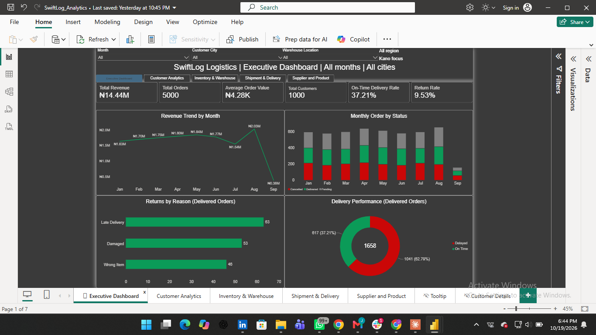
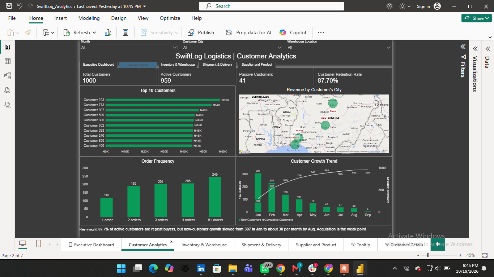
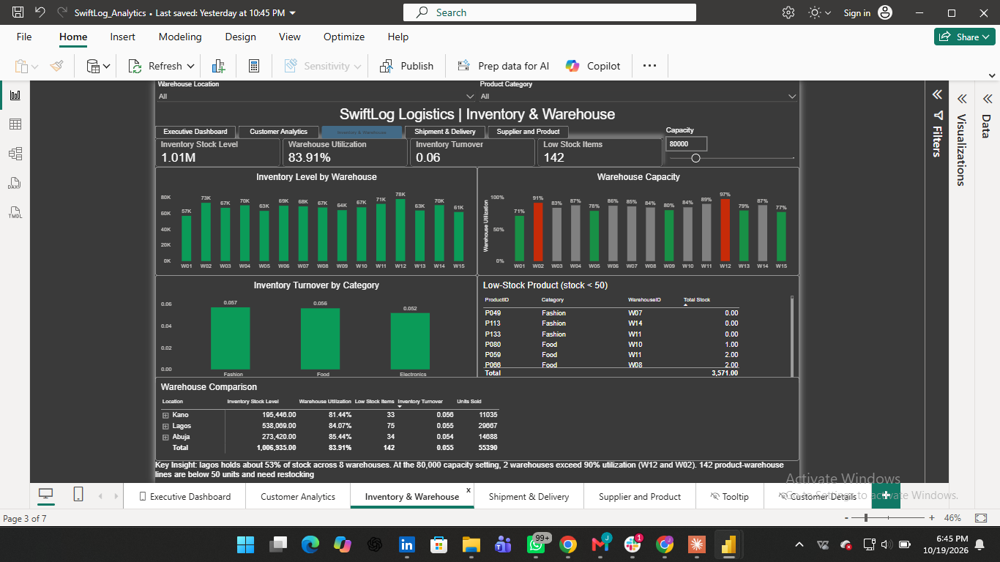
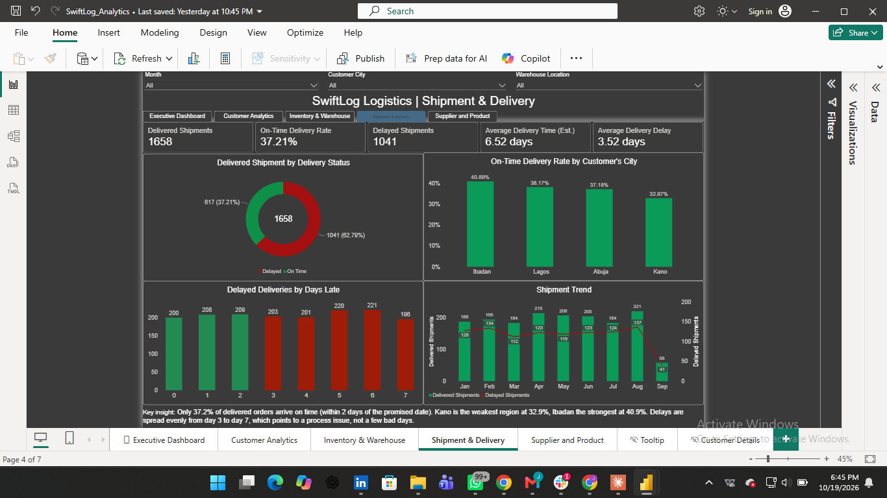
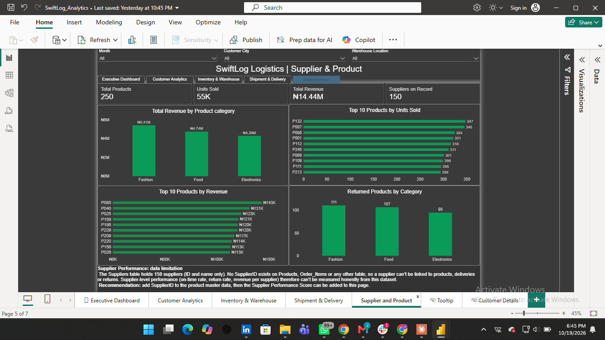
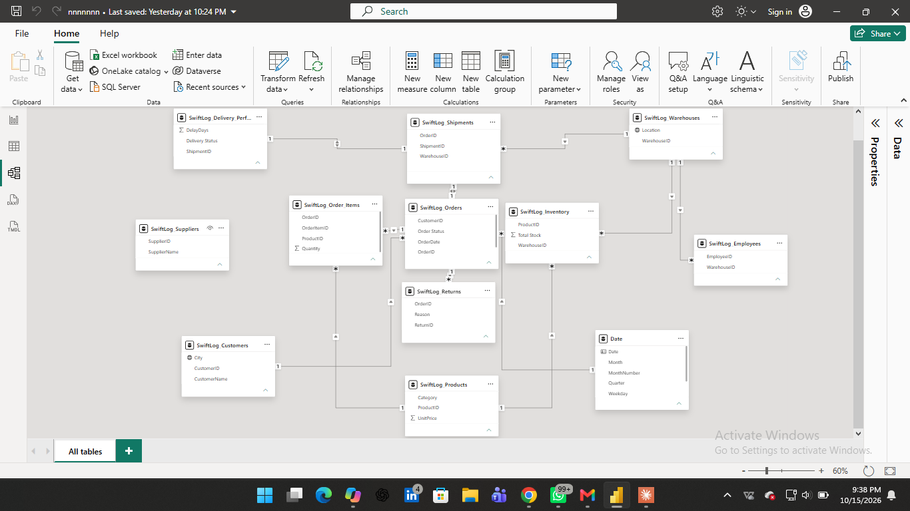

# SwiftLog Logistics: Supply Chain Analytics & Business Intelligence

**AnalystLab Africa Experience Lab, Week 5 (Data Analytics track)**
**Author:** Okoro Joseph Ifeanyichukwu
**Tool:** Microsoft Power BI Desktop
**Data period:** 1 Jan 2026 to 8 Sep 2026 (September is a partial month)

---

## 1. Project overview

SwiftLog is a logistics and e-commerce fulfilment business operating from 15 warehouses (8 in Lagos, 4 in Abuja, 3 in Kano) and serving customers in Lagos, Abuja, Kano and Ibadan.
This project turns 12 raw operational files into a five-page interactive Power BI dashboard, an executive report and a presentation. It answers where revenue comes from, how well deliveries perform, why orders are returned, how stock is held across warehouses, and what management should do next.

### Headline findings

| Area | Finding |
|---|---|
| Revenue | ₦14.44M from non-cancelled orders; August is the peak month (₦2.03M) |
| Order completion | Only 33.2% of orders are Delivered; 34.3% are still Pending and 32.5% Cancelled (cancelled orders carry ₦7.23M of value) |
| Delivery | 37.21% of delivered orders arrive on time; average delay 3.52 days; Kano is weakest (32.87%) and Ibadan strongest (40.89%) |
| Returns | 9.53% of delivered orders are returned; late delivery is the most common stated reason |
| Customers | 87.7% of active customers are repeat buyers, but new-customer acquisition fell from 307 in January to about 30 a month by August |
| Inventory | 1.01M units in stock, turnover 0.055; W12 (96.9%) and W02 (91.0%) exceed 90% utilisation at an assumed 80,000-unit capacity; 142 product-warehouse lines are below 50 units |
| Suppliers | Supplier performance cannot be measured: no table links suppliers to products (documented limitation) |

### Dashboard Preview







---

## 2. Folder structure

```
Week5_DataAnalytics_SwiftLog_Okoro_Joseph/
├── Data/                       12 original CSV files (unchanged)
├── Dashboard/
│   └── SwiftLog_Analytics.pbix Power BI report (5 pages + tooltip + drill-through)
├── Report/
│   ├── Executive_BI_Report.pdf
│   └── Dashboard_Screenshots.pdf
├── Presentation/
│   └── Executive_Presentation.pptx
├── Images/                     Dashboard page screenshots and the data model
├── References/                 Assignment brief
└── README.md
```

---

## 3. Data model (Part 1)

All tables are loaded with the prefix `SwiftLog_`. The Date table and the measures table are created in the model.

| Table | Rows | Role | Key columns |
|---|---|---|---|
| Customers | 1,000 | Dimension | CustomerID, CustomerName, City |
| Products | 250 | Dimension | ProductID, Category, UnitPrice |
| Warehouses | 15 | Dimension | WarehouseID, Location |
| Date | 365 | Dimension (marked as date table) | Date, Year, Month, MonthNumber, Quarter |
| Orders | 5,000 | Fact | OrderID, CustomerID, OrderDate, Order Status |
| Order_Items | 15,000 | Fact | OrderItemID, OrderID, ProductID, Quantity |
| Shipments | 5,000 | Fact | ShipmentID, OrderID, WarehouseID, DelayDays |
| Delivery_Performance | 5,000 | Fact | ShipmentID, Delivery Status, DelayDays |
| Inventory | 2,455 (after cleaning) | Fact | WarehouseID, ProductID, Total Stock |
| Returns | 500 | Fact | ReturnID, OrderID, Reason |
| Employees | 200 | Reference (not used in visuals) | |
| Suppliers | 150 | Reference, **not connected** | SupplierID, SupplierName |

### Relationships

- Customers (1) to Orders (many) on CustomerID
- Orders (1) to Order_Items (many) on OrderID
- Products (1) to Order_Items (many) and to Inventory (many) on ProductID
- Orders (1) to Shipments (1) on OrderID (one-to-one, both directions)
- Shipments (1) to Delivery_Performance (1) on ShipmentID (one-to-one, both directions)
- Warehouses (1) to Shipments (many) and to Inventory (many) on WarehouseID
- Orders (1) to Returns (many) on OrderID
- Date (1) to Orders (many) on Date and OrderDate
- Suppliers has no relationship (see Limitations)

The model screenshot is saved in `Images/` (add `Data_model.png` from the Model view if not already there).

---

## 4. Data cleaning and transformation log (Part 2)

Quality checks run before modelling: row counts, nulls, duplicate keys, referential integrity between every fact and dimension, value ranges and date range.

| # | Table | Transformation | Why |
|---|---|---|---|
| 1 | All | Loaded the 12 CSVs and prefixed the tables with `SwiftLog_`; promoted headers; set data types | Consistent naming and correct types |
| 2 | Orders | Converted `OrderDate` (m/d/yyyy text) to Date type; renamed `Status` to `Order Status` | Time intelligence and a clear measure filter |
| 3 | Delivery_Performance | Renamed `Status` to `Delivery Status` (On Time = 0-2 days, Delayed = 3-7 days, the dataset's own labels) | Avoids a clash with Order Status |
| 4 | Inventory | Removed 3 exact duplicate rows | Stock would otherwise be double counted |
| 5 | Inventory | Grouped by WarehouseID + ProductID and summed Stock into `Total Stock` (4,000 rows to 2,455) | The file has no snapshot date, so repeated pairs are treated as additional stock lines |
| 6 | Date | Built a Date table with DAX (1 Jan to 31 Dec 2026) with Year, Month, MonthNumber, Quarter and Year-Month; marked as the date table; Month sorted by MonthNumber; auto date/time switched off | A single, consistent calendar |
| 7 | Data_Dictionary | Excluded from the model (every file is described only as "Dataset") | No analytical value |
| 8 | Model | `Order Status` (Delivered, Pending, Cancelled) and `Delivery Status` (On Time, Delayed) used as the business categories for completed, pending, cancelled and on-time or delayed analysis | Consistent categories for visuals and measures |

Further check: all 250 products appear in Inventory, and every product that was sold has stock records.

---

## 5. KPIs and DAX measures (Part 3)

All measures live in the `_Measures` table.

| # | Measure | DAX (summary) | Business value |
|---|---|---|---|
| 1 | Total Orders | `DISTINCTCOUNT(Orders[OrderID])` | Demand volume (5,000) |
| 2 | Delivered Orders | `CALCULATE([Total Orders], Orders[Order Status]="Delivered")` | Orders actually fulfilled (1,658) |
| 3 | Total Revenue | `SUMX(Order_Items, Quantity * RELATED(Products[UnitPrice]))` excluding Cancelled | Recognised sales value (₦14.44M) |
| 4 | Average Order Value | Revenue / non-cancelled orders | Basket size (₦4.28K); supports pricing and bundling |
| 5 | Total Customers | `DISTINCTCOUNT(Customers[CustomerID])` | Registered customer base (1,000) |
| 6 | Active Customers | Distinct customers with a non-cancelled order | Buying base (959) |
| 7 | Passive Customers | Total minus Active | Dormant base to re-activate (41) |
| 8 | Repeat Customers | Customers with 2 or more non-cancelled orders | Loyalty (841) |
| 9 | Customer Retention Rate | Repeat / Active | Loyalty health (87.7%) |
| 10 | On-Time Delivery Rate | On-time delivered shipments / delivered shipments | Service quality (37.21%) |
| 11 | Delayed Shipments | Delayed status among delivered orders | Size of the service problem (1,041) |
| 12 | Average Delivery Delay | Average DelayDays on delivered orders | Days lost per delivery (3.52) |
| 13 | Average Delivery Time (Est.) | Standard Delivery Days (What-If, default 3) + Average Delivery Delay | Customer-facing delivery promise (about 6.5 days) |
| 14 | Orders Returned | Distinct OrderID in Returns | Returned orders (counts each order once) |
| 15 | Return Rate | Delivered orders with a return / delivered orders | Quality and service cost signal (9.53%) |
| 16 | Returned Orders (by Product) | Orders Returned with a two-way filter between Orders and Order_Items | Returns by product category |
| 17 | Inventory Stock Level | `SUM(Inventory[Total Stock])` | Units on hand (1,006,935) |
| 18 | Units Sold | Quantity on non-cancelled orders | Sales volume (55,390) |
| 19 | Inventory Turnover | Units Sold / Stock Level | How hard stock works (0.055) |
| 20 | Low Stock Items | Inventory lines with stock below 50 | Stock-out risk (142) |
| 21 | Warehouse Capacity Value | What-If parameter, 70,000 to 120,000 | Scenario input for capacity planning |
| 22 | Warehouse Utilization | Stock / (Capacity x warehouses in context) | Space pressure (83.9% overall at 80,000) |
| 23 | New Customers / Cumulative Customers | First non-cancelled order month; running total | Acquisition trend (307 in Jan to 4 in Sep) |
| 24 | Suppliers on Record | `DISTINCTCOUNT(Suppliers[SupplierID])` | Catalogue count (150) |

The Order Frequency chart uses a helper table, `Order Frequency Bands`, with the measures `Orders per Customer` and `Customers in Band`.

---

## 6. Dashboard pages (Part 4)

| Page | Purpose | Main visuals |
|---|---|---|
| 1. Executive Dashboard | Whole-business view | 6 KPI cards, revenue trend, orders by month and status, delivery donut, returns by reason, Month, City and Location slicers |
| 2. Customer Analytics | Who buys and how often | Retention cards, Top 10 customers, revenue by city map, order frequency, customer growth trend |
| 3. Inventory & Warehouse | Stock and capacity | Stock level and turnover cards, stock by warehouse, utilisation (colour rules at 80% and 90%), turnover by category, low-stock list, warehouse comparison matrix, What-If capacity slicer |
| 4. Shipment & Delivery | Service quality | Delivery cards, status donut, on-time rate by city, days-late distribution, shipment trend |
| 5. Supplier & Product | Product performance | Revenue by category, top 10 by units, top 10 by revenue, returns by category, supplier limitation note |

### Interactive features

- **Navigation:** page navigator on every page
- **Synchronised slicers:** Month, Customer City and Warehouse Location
- **Cross-filtering:** all visuals on a page filter each other
- **Drill-through:** Customer Detail page, reached from the Top 10 Customers chart
- **Dynamic tooltip:** a hidden Tooltip page on the Top 10 Customers chart
- **Bookmarks:** All Regions and Kano Focus, with buttons
- **Dynamic title:** Executive page title responds to slicer selections
- **Conditional formatting:** utilisation bars (red at 90% or above, grey 80-90%, green below 80%)
- **What-If parameters:** Warehouse Capacity (70,000 to 120,000) and Standard Delivery Days (1 to 7)
- **Mobile layout:** built for the Executive page
- **Theme:** dark theme with a green and red accent palette

---

## 7. Assumptions

1. **Revenue** = Quantity x UnitPrice. Cancelled orders are excluded; Pending orders are included.
2. **Average Order Value** divides revenue by the 3,374 non-cancelled orders in the Orders table.
3. **Delivery and return metrics** use Delivered orders only.
4. **On time** means 0-2 delay days, as the dataset labels it.
5. **Return Rate** counts distinct delivered orders with a return (158 of 1,658 = 9.53%). Counting return records instead gives 9.95%.
6. **Returns have no ProductID**, so product-level returns are attributed through the order's items. An order with several categories is counted under each one.
7. **Delivery region** = the customer's city (where the parcel goes). Warehouse Location is the origin and is available as a second slicer.
8. **Warehouse capacity** is not in the data. 80,000 units per warehouse is an assumption, adjustable between 70,000 and 120,000 with a What-If slicer.
9. **Low stock** = fewer than 50 units in a product-warehouse line.
10. **Average Delivery Time** is an estimate: an assumed standard window of 3 days plus the observed average delay.
11. **Customer Retention Rate** = customers with 2 or more non-cancelled orders / customers with at least 1.
12. **Total Customers** counts the registered base (1,000). Product and supplier counts are catalogue totals and do not respond to date, city or warehouse filters.
13. **September 2026** contains data only up to 8 September, so the September values are partial.
14. **Currency** is assumed to be Nigerian Naira (₦).
15. The data appears synthetic (near-uniform distributions), so patterns should be read as indicative.

---

## 8. Limitations

- **Supplier performance cannot be measured.** The Suppliers table holds only SupplierID and SupplierName; no SupplierID exists on Products, Order_Items, Shipments or Returns. No supplier score is shown rather than inventing one.
- **Inventory has no date**, so it is a single snapshot and stock trends cannot be analysed.
- **Returns have no product or cost value**, so the financial cost of returns cannot be measured.
- **Shipments have no dispatch or delivery dates**, only a delay in days.
- **Employees** data has no link to orders or warehouses.
- **Data Dictionary** is not usable (every file is described as "Dataset").

---

## 9. How to open

1. Open `Dashboard/SwiftLog_Analytics.pbix` in Power BI Desktop (any recent version).
2. If prompted, point the data source at the `Data/` folder.
3. Use the navigator buttons to move between pages.

## 10. References

- AnalystLab Africa Week 5 assignment brief (`References/`)
- Microsoft Power BI documentation: DAX, What-If parameters, drill-through, tooltips, bookmarks
